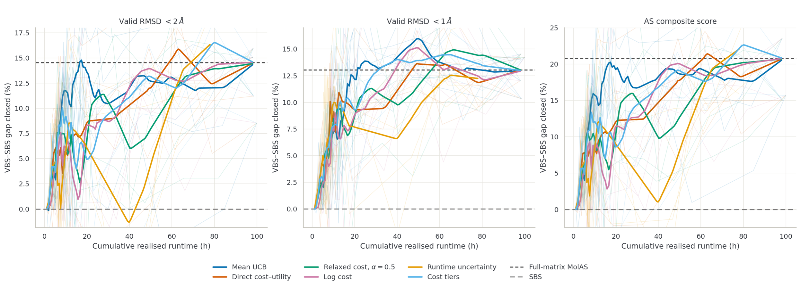

<h1 align="center">🧬 MolAS Active Learning</h1>

<p align="center">
  <strong>Active Learning for Molecular-Docking Algorithm Selection<br>under Heterogeneous Runtime</strong><br>
  Accepted at the NeurIPS 2026 Workshop on AI for Drug Discovery (AI4DD)
</p>

<p align="center">
  Sean Wan · Jiabao Brad Wang · Mustafa Misir<br>
  <strong>Duke Kunshan University</strong>
</p>

<p align="center">
  
  
  
  
  
  
  
  
</p>

<p align="center">
  <a href="paper/AI4DD52_camera_ready.pdf">📄 Paper</a> ·
  <a href="https://openreview.net/forum?id=tSz3wBLABm">📝 OpenReview</a> ·
  <a href="#quickstart">🚀 Quick start</a> ·
  <a href="#repository">🗂️ Repository map</a> ·
  <a href="docs/data_card.md">🗃️ Data card</a> ·
  <a href="#citation">📚 Citation</a>
</p>

---

<a id="overview"></a>

## 🔬 Overview

**Can selective docking evaluations provide useful training data for algorithm selection at a lower acquisition cost?** We study this question through retrospective, cell-wise active learning: each query reveals the outcome and runtime of one protein–ligand complex paired with one docking algorithm.

Using the existing **MolAS** selection system, we compare **Mean-UCB and five runtime-aware formulations**. Evaluation follows cumulative realized docking time, per-engine acquisition allocation, matrix diagnostics, and held-out selector performance.

The main findings in the reported setting are:

- **Partial acquisition can support useful selectors** without measuring the full training matrix.
- **The preferred runtime formulation depends on the budget and endpoint.** No evaluated formulation consistently leads across the reported comparison.
- **Matrix reconstruction quality does not consistently track downstream decision quality.** Acquisition should be assessed using realized cost and held-out selection outcomes.

> [!NOTE]
> The benchmark uses **precomputed docking outcomes in retrospective simulation**. These descriptive results concern the tested benchmark and portfolio; prospective performance and superiority over untested acquisition baselines remain open questions.

<a id="snapshot"></a>

## ✨ Research snapshot

| Dimension | Included evidence |
|---|---|
| Benchmark | **3,179 complexes × 7 docking engines**; 22,253 cells per full matrix |
| Acquisition comparison | **6 policies** with a shared Mean-UCB utility definition and predictive model class |
| Held-out evaluation | **5 outer folds** with the original fixed complex memberships |
| Acquisition archive | **90 runs** across 6 policies × 5 folds × 3 acquisition seeds |
| Original acquisition CSVs | **27,000 verified CSV identities**, recoverable from the compressed run archives |
| Downstream saved results | **4,508 original CSVs** in six policy ZIPs, plus readable summary mirrors |
| Downstream seed scope | Reported saved folders use **acquisition seed 0**; other acquisition seeds are not additional downstream replications |
| Paper assets | Camera-ready PDF, LaTeX source, bibliography, and **8 unchanged figure assets** |

Each policy updates its predictions from its own acquired observations. The five outer folds are not independent selector-seed replications. See the [downstream protocol and saved-output coverage](docs/downstream_reproduction.md) for the evidence behind these counts and the distinction between acquisition and selector seeds.

<a id="quickstart"></a>

## 🚀 Quick start

### Inspect and validate the published artifacts

Python **3.11 or newer** is recommended for the repository's verification tools. These commands use the standard library and require no GPU:

```bash
git clone https://github.com/SeanWan514/MolAS_Active_Learning.git
cd MolAS_Active_Learning

python3 scripts/verify_repository.py --strict-release
python3 scripts/validate_data.py --require-complete
```

The first command checks the frozen Git-visible file hashes and recorded publication readiness. The second checks the included acquisition inputs, IDs, schemas, and data consistency. Both work without the separately released structural graphs. File integrity and exact end-to-end scientific reproduction are reported separately.

<details>
<summary><strong>🧪 Install acquisition dependencies and run the focused software checks</strong></summary>

```bash
python3 -m venv .venv
.venv/bin/python -m pip install -r requirements.txt
.venv/bin/python -m unittest discover -s code/acquisition/tests -v
.venv/bin/python code/acquisition/run_experiment.py --help
```

The unit checks use fabricated inputs. They do not execute docking, an acquisition campaign, or selector training. Dependency constraints and the recorded release test environment are not a reconstructed historical environment lock.

Instructions for new acquisition runs are in [code/acquisition/README.md](code/acquisition/README.md). The recovered downstream workflow and its dependency/path requirements are in [code/downstream/README.md](code/downstream/README.md).

</details>

<a id="results"></a>

## 📊 Reported results

The figure below shows held-out MolAS outcomes against **cumulative realized docking runtime**, using the three reported decision endpoints. It is an unchanged figure from the paper.



The curves show budget-dependent trade-offs among the evaluated policies. Consult the [paper](paper/AI4DD52_camera_ready.pdf) for endpoint definitions and interpretation, and the [figure-lineage record](provenance/figure_lineage.json) for the preserved source-to-asset evidence.

- [Acquisition artifacts and original CSV identities](results/acquisition/README.md)
- [Downstream predictions and metrics](results/downstream/) · [Archive verification](results/downstream/verification.json)
- [Recovered analysis and reproduction limits](docs/downstream_reproduction.md)

<a id="policies"></a>

## 🧭 Acquisition policies

| Policy ID | Formulation |
|---|---|
| `plain_mean_ucb` | Mean-UCB reference |
| `direct_cost_uc` | Direct cost–utility formulation |
| `relaxed_cost_power_05` | Relaxed cost weighting, power 0.5 |
| `log_cost` | Log-cost formulation |
| `runtime_uncertainty` | Runtime-uncertainty formulation |
| `cost_tiers_5` | Five runtime cost tiers |

The comparison fixes the base utility definition and model class while varying runtime handling. It does not establish a universal ordering of cost pressure or policy performance. Earlier hybrid, DAL, and pilot experiments are excluded from the paper comparison; see [workspace selection](docs/workspace_audit.md).

<a id="repository"></a>

## 🗂️ Repository map

```text
MolAS_Active_Learning/
├── code/
│   ├── acquisition/       # portable six-policy acquisition and completion code
│   └── downstream/        # historical MolAS adapter, analysis, and path helpers
├── data/                  # raw tables, targets, fixed folds, descriptors, features
├── results/
│   ├── acquisition/       # compressed original matrices and query records
│   └── downstream/        # original predictions, metrics, and summary mirrors
├── paper/                 # camera-ready PDF, LaTeX source, and figure assets
├── provenance/            # historical source, hashes, figure lineage, verification
├── scripts/               # packaging, extraction, and integrity utilities
├── docs/                  # data card, reproduction records, and source attribution
├── LICENSE                # MIT license for original software
└── CITATION.cff           # software and preferred-paper citation metadata
```

The recovered historical MolAS adapter and the pinned official upstream reference are kept separately under `code/downstream/`. Original inspected acquisition source is preserved under [provenance/historical_acquisition_source/](provenance/historical_acquisition_source/). The portable release implementation and its documented software corrections are distinct from these historical snapshots.

<a id="data"></a>

## 🗃️ Data availability

**Included now:** original score/runtime tables, strict targets, fixed folds, physical descriptors, small feature artifacts, archived acquisition matrices/query records, and saved downstream predictions/metrics.

**Separate release in preparation:** the **3,179 original protein graphs**, totaling **14,985,036,224 bytes (about 15 GB)**. They are Git-ignored and absent from this GitHub release. Their actual versioned dataset URL will be added after publication; the [graph checksum manifest](provenance/external_graph_checksums.json) is already included.

The small feature cache supports the acquisition input contract. The historical downstream MolAS workflow additionally requires the structural data. See the [data card](docs/data_card.md) for sources, schemas, units, and checks, and [data/README.md](data/README.md) for the input layout.

The docking-engine column order is `surfdock`, `unimol`, `diffdock`, `diffdock_l`, `gnina`, `autodock`, `smina`. Acquisition strict-score targets and native MolAS evaluation targets have distinct definitions and files; preserve that distinction when using the analysis tools.

<a id="reproducibility"></a>

## 🔎 Reproducibility and interpretation

The repository preserves historical outputs and documents the available source evidence. **No new docking, acquisition campaign, or selector-training experiment was run during release preparation.** Exact end-to-end historical reproduction has not been newly verified.

<details>
<summary><strong>Protocol boundaries and historical provenance</strong></summary>

- Runtime fitting uses previously observed training-pool runtimes. Preserve the original outer folds, held-out outcomes, and warm-start cost accounting when implementing acquisition.
- Full outcome tables are retrospective oracles. Unqueried labels and held-out outcomes must not be used by an acquisition policy. Completed matrices contain both observed and imputed values.
- Raw numeric values are preserved. Extreme RMSD values and their unestablished failure/sentinel interpretation are documented in the data card.
- The historical adapter, launcher, analysis notebooks, runtime-probe source, and plotting scripts are included. Launcher defaults do not establish the exact configuration of every archived invocation.
- All eight paper figure assets are included, with source correspondence documented to the extent supported by the recovered records. Some final export/layout details and per-run training configurations remain unpinned.
- The known incremental-log resume defect is documented; original records have not been silently repaired. The corrected portable runner is identified separately.
- The supplied PDF remains unchanged, including its original availability statement. LaTeX source is at [paper/source/[AI4DD]main.tex](paper/source/%5BAI4DD%5Dmain.tex), with the original style, bibliography, appendix, and figures.

</details>

Read the [reproduction record](docs/downstream_reproduction.md), [release verification guide](docs/release_workflow.md), and [machine-readable status](provenance/release_status.json) for the detailed evidence and remaining dataset-publication work.

<a id="citation"></a>

## 📚 Citation

If you use this code or its research artifacts, please cite the associated AI4DD paper. Machine-readable metadata is in [CITATION.cff](CITATION.cff).

```bibtex
@inproceedings{wan2026molas_active_learning,
  title     = {Active Learning for Molecular-Docking Algorithm Selection under Heterogeneous Runtime},
  author    = {Wan, Sean and Wang, Jiabao Brad and Misir, Mustafa},
  booktitle = {NeurIPS Workshop on AI for Drug Discovery},
  year      = {2026},
  url       = {https://openreview.net/forum?id=tSz3wBLABm}
}
```

## 📜 License and attribution

Original software and associated software documentation are released under the **[MIT License](LICENSE)**. Third-party software retains its supplied notices. Data, research results, embeddings, model weights, the manuscript, and figures retain their separately applicable terms.

The author confirmed the redistribution terms for this GitHub release; see [NOTICE.md](NOTICE.md), [third-party provenance](docs/third_party.md), and the [confirmation record](provenance/author_redistribution_confirmation.json). The separate dataset release will provide its own version and component terms.

<p align="center">
  <a href="#overview">↑ Back to overview</a>
</p>
